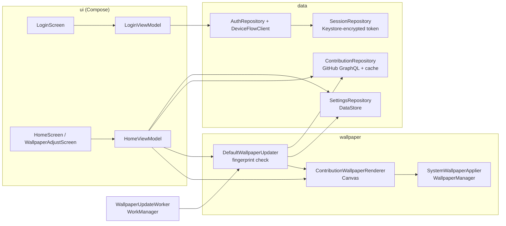

<div align="center">


# Git Wallpaper

**Your GitHub contribution graph as your Android lock screen wallpaper, always up to date.**

[](https://github.com/lucasmarujo/git-android-wallpaper/actions/workflows/android.yml)


</div>

Git Wallpaper is a native Android app that draws your GitHub contribution graph as a wallpaper for the lock screen, the home screen, or both, and keeps it in sync with your commits in the background. Everything runs on the device: there is no backend, no analytics and no ads. The app talks only to GitHub.

<table>
  <tr>
    <td align="center"><br /><sub>Lock screen</sub></td>
    <td align="center"><br /><sub>Home screen</sub></td>
    <td align="center"><br /><sub>Preview and stats</sub></td>
  </tr>
  <tr>
    <td align="center"><br /><sub>Pinch to zoom, drag to position</sub></td>
    <td align="center"><br /><sub>Any commit color</sub></td>
    <td align="center"><br /><sub>Sign in with GitHub</sub></td>
  </tr>
</table>

<sub>Screenshots show the Brazilian Portuguese interface. The app is also fully available in English.</sub>

## Contents

- [Features](#features)
- [How it works](#how-it-works)
- [Installation](#installation)
- [Privacy and security](#privacy-and-security)
- [Troubleshooting](#troubleshooting)
- [Tech stack](#tech-stack)
- [Architecture](#architecture)
- [Building from source](#building-from-source)
- [Testing](#testing)
- [Continuous integration and releases](#continuous-integration-and-releases)
- [Roadmap](#roadmap)
- [Contributing](#contributing)
- [License](#license)
- [Disclaimer](#disclaimer)

## Features

### A wallpaper made from your year

- **One square per day** of the current year or of the last 12 months, laid out as a vertical grid that fits phone screens. The number of columns adapts to the screen's aspect ratio.
- **Today is ringed**, and future days are dimmed, so you can see at a glance where you are in the year.
- **An optional footer** shows the total contributions, the current and longest streaks, your avatar and your `@username`.
- **Rendered on the device at the screen's physical resolution.** The grid stays sharp on every display.
- **Lock screen safe zones.** By default the content sits between the clock and the unlock or shortcut area, and it already compensates for the roughly 1.1× zoom Android applies to wallpapers.

### Adjustable framing (new in 1.1)

- **A lock screen preview before every apply.** Tapping **Apply wallpaper** opens a full-screen preview of the lock screen, with a simulated clock.
- **Gestures:** pinch to zoom (0.5× to 2.5×) and drag to reposition the graph. **Reset** restores the default framing.
- **The framing persists.** It is saved and reused by every automatic update, so the wallpaper never jumps back to the default position.

### Personalization

| Setting | Options |
| --- | --- |
| Apply to | Lock screen, home screen, or both |
| Theme | Dark (GitHub), Light, AMOLED, Ocean, Sunset |
| Commit color | The theme's colors, or any color from an RGB picker with live preview and hex code. The four contribution levels are derived from the chosen color, while the theme keeps the background and text. |
| Period | This year, or the last 12 months |
| Cell shape | Rounded squares or circles |
| Stats footer | On or off |
| Automatic update | On or off, checking GitHub every 30 min, 1 h, 3 h, 6 h or 12 h |

### Hands-off updates

- **Background updates through WorkManager.** There is one unique periodic job, with no network constraint and exponential backoff.
- **When it redraws:** after a new contribution, and at the turn of each day so the "today" ring moves, even offline using the cached calendar.
- **It keeps running** after a reboot or an app update.
- **No redundant redraws.** Each run compares a SHA-256 fingerprint of everything that affects the pixels (calendar, settings, framing, color, screen size, locale and date) and skips identical renders.
- **Battery-optimization shortcut.** A built-in shortcut opens the system settings so Android does not defer updates. The app does not request the exemption directly, in line with Google Play policy.

### Sign-in

- **GitHub OAuth Device Flow.** No backend and no client secret are involved. The app shows the verification link with **Open link** and **Copy link** buttons, plus a one-tap **Copy code and open GitHub** action.
- **Fallback:** a Personal Access Token with the `read:user` scope.

### Localization

The app is available in English and Brazilian Portuguese, with per-app language support on Android 13 and later.

## How it works

1. **Sign in** with GitHub. Open the verification link, enter the code shown in the app and authorize it, on the phone or on any other device.
2. **Pick your style:** where to apply it, theme, commit color, period, cell shape and whether to show stats. The preview updates as you change options.
3. **Tap Apply wallpaper**, adjust the zoom and position on the lock screen preview, and confirm.
4. **That's it.** The app checks GitHub on the interval you chose and redraws the wallpaper whenever something changed. You do not need to open it again.

Under the hood, each update reads your contribution calendar through the GitHub GraphQL API (`viewer { login avatarUrl contributionsCollection { contributionCalendar } }`), renders a bitmap with Android's `Canvas`, and applies it with `WallpaperManager.setBitmap` using `FLAG_LOCK` and/or `FLAG_SYSTEM`.

## Installation

- **Google Play:** the app (`dev.marujo.gitwallpaper`) is currently in closed testing. If you are on the tester list, join through the [testing page](https://play.google.com/apps/testing/dev.marujo.gitwallpaper) and install it from Google Play. A public listing will follow after the testing period.
- **GitHub Releases:** tagging a version (`v*`) publishes a signed APK to [Releases](../../releases). Installing it requires allowing installs from unknown sources.
- **From source:** see [Building from source](#building-from-source).

**Requirements:** Android 8.0 (API 26) or later, and a GitHub account.

## Privacy and security

- **On-device only.** There is no server, analytics, tracking, ads or third-party SDKs. No data is sent to the developer.
- **Encrypted token.** The GitHub token is encrypted with AES-256-GCM using a key held in the Android Keystore, and it is sent only to GitHub over HTTPS.
- **Minimal scope:** `read:user`.
- **Network access is limited to GitHub:**
  - `github.com` for sign-in;
  - `api.github.com` for contributions;
  - `avatars.githubusercontent.com` for your avatar.
- **Backups and cleartext are off.** App data is excluded from cloud backup and device-to-device transfer, and cleartext traffic is disabled.
- **Sign out** deletes the token and the contributions cache, and stops automatic updates. You can also revoke access at any time at [github.com/settings/applications](https://github.com/settings/applications).
- **Privacy policy:** [lucasmarujo.github.io/git-android-wallpaper/privacy](https://lucasmarujo.github.io/git-android-wallpaper/privacy/). The source is in [`docs/privacy/index.md`](docs/privacy/index.md), published with GitHub Pages.

**Permissions**

| Permission | Why |
| --- | --- |
| `INTERNET` | Talk to GitHub |
| `SET_WALLPAPER` | Apply the generated image |
| `RECEIVE_BOOT_COMPLETED`, `WAKE_LOCK`, `ACCESS_NETWORK_STATE`, `FOREGROUND_SERVICE` | Added by WorkManager to run and reschedule background updates |

## Troubleshooting

<details>
<summary><strong>My private contributions are missing</strong></summary>

Enable **Private contributions** in your GitHub profile settings. GitHub then includes them, anonymized, in your contribution calendar.
</details>

<details>
<summary><strong>The wallpaper stops updating on its own</strong></summary>

Some manufacturers (for example Xiaomi, Samsung and Huawei) aggressively restrict background work. When the app shows the battery hint, tap **Open battery settings** and set Git Wallpaper to **Don't optimize** (or **Unrestricted**). If you **force stop** the app, Android cancels its scheduled work until you open it again. This is a system rule.
</details>

<details>
<summary><strong>The clock covers part of the graph</strong></summary>

Lock screen clocks differ across Android versions and manufacturers. Tap **Apply wallpaper** and drag or zoom the graph in the preview until it sits where you like. The framing is kept for all future updates.
</details>

<details>
<summary><strong>The graph looks slightly smaller or larger than in the preview</strong></summary>

The safe zones assume AOSP's default wallpaper zoom of about 1.1×. On devices that do not zoom the wallpaper, the content appears slightly more compact. Adjust it once in the framing editor.
</details>

<details>
<summary><strong>"GitHub sign-in is unavailable"</strong></summary>

The build has no OAuth Client ID configured, or GitHub rejected the Device Flow request. Use **Use a personal access token** with the `read:user` scope instead.
</details>

## Tech stack

| Area | Choice |
| --- | --- |
| Language | Kotlin 2.4 (JVM 17 bytecode, built with JDK 21) |
| UI | Jetpack Compose, Material 3 (Compose BOM 2026.09) |
| Background work | WorkManager 2.12 |
| Storage | DataStore Preferences 1.3 |
| Networking | OkHttp 5 with kotlinx.serialization (GitHub GraphQL) |
| Security | Android Keystore with AES-256-GCM |
| Build | Android Gradle Plugin 9.4, Gradle 9.8, version catalog |
| SDK levels | `compileSdk 37`, `targetSdk 36`, `minSdk 26` |
| Tests | JUnit 4, Robolectric 4.17 (native graphics), Compose UI tests, kotlinx-coroutines-test, MockWebServer, WorkManager testing |

## Architecture

A single `app` module, organized in layers with manual dependency injection through `AppContainer`. The same renderer produces the in-app preview and the real wallpaper, so what you see is what gets applied.



```
app/src/main/java/com/lucasmarujo/gitwallpaper
├── domain/      Pure models and rules: calendar, stats, settings, framing, periods, themes
├── data/        GitHub GraphQL, avatar cache, Device Flow, encrypted session, DataStore
├── wallpaper/   Day grid, layout and safe zones, Canvas renderer, palettes, fingerprint, applier
├── work/        WorkManager worker, factory and scheduler
└── ui/          Compose screens (login, home, framing editor, color picker) and theme
```

Design and planning notes, in Portuguese, live in [`docs/PLANEJAMENTO.md`](docs/PLANEJAMENTO.md).

## Building from source

**Prerequisites:** JDK 21 and the Android SDK with platform 37 (Android Studio installs both).

```bash
git clone https://github.com/lucasmarujo/git-android-wallpaper.git
cd git-android-wallpaper
./gradlew assembleDebug        # app/build/outputs/apk/debug/app-debug.apk
./gradlew installDebug         # install on a connected device or emulator
```

### GitHub OAuth App (Device Flow)

The OAuth Client ID is read from `gradle.properties` (`gitWallpaper.githubClientId`). It is not a secret, because the Device Flow uses no client secret. To use your own OAuth App:

1. Create an OAuth App at <https://github.com/settings/applications/new> and check **Enable Device Flow**.
2. Replace `gitWallpaper.githubClientId`, or pass it at build time: `./gradlew assembleDebug -PgitWallpaper.githubClientId=YOUR_CLIENT_ID`.

Without a Client ID the app still works, with Personal Access Token sign-in only.

### Signed release builds

Release builds are minified and resource-shrunk. They are signed when a `keystore.properties` file exists at the project root. The file is git-ignored.

```properties
storeFile=/absolute/path/to/release.jks
storePassword=...
keyAlias=git-wallpaper
keyPassword=...
```

Each value can also come from the `SIGNING_STORE_FILE`, `SIGNING_STORE_PASSWORD`, `SIGNING_KEY_ALIAS` and `SIGNING_KEY_PASSWORD` environment variables.

```bash
./gradlew assembleRelease      # signed APK
./gradlew bundleRelease        # signed Android App Bundle for Google Play
```

Google Play distribution uses Play App Signing: the local keystore is the upload key.

## Testing

The project has 190 unit tests that run on the JVM, using Robolectric for Android APIs and native graphics.

```bash
./gradlew testDebugUnitTest    # unit and Robolectric tests
./gradlew lintDebug            # Android Lint
```

The tests cover:

- **Domain:** stats and streaks, the day grid (current year, leap years, last 12 months, GitHub's timezone ahead of the device), vertical layout and safe zones, framing limits, fingerprints.
- **Rendering with real pixels:** bitmap size, theme backgrounds, colors per contribution level, future days, the today ring, circles versus squares, the stats footer, the avatar, custom commit colors, zoom and position.
- **Data:** GraphQL parsing and errors, Device Flow polling, token encryption and session lifecycle, avatar cache, settings persistence and migration of stored values.
- **Orchestration:**
  - the updater: apply, skip when unchanged, force, a new day online and offline, cache fallback, revoked tokens, wallpaper failures, framing kept by automatic updates;
  - the worker's result mapping;
  - unique scheduling in WorkManager.
- **UI (Compose):** sign-in states, open and copy link actions, settings, the RGB color picker, the framing editor's gestures (pinch, drag, reset, cancel) and the status bar appearance.

## Continuous integration and releases

[GitHub Actions](.github/workflows/android.yml) runs on every push to `main` and on every pull request:

1. Unit tests, lint and a debug build on JDK 21.
2. Uploads the test and lint reports and the debug APK as artifacts.

Pushing a tag that matches `v*` also builds a signed release APK and publishes it as a GitHub Release with generated notes. That job needs the `SIGNING_KEYSTORE_BASE64`, `SIGNING_STORE_PASSWORD`, `SIGNING_KEY_ALIAS` and `SIGNING_KEY_PASSWORD` repository secrets.

```bash
git tag v1.1.0
git push origin v1.1.0
```

## Roadmap

- Home screen widget that reuses the same renderer.
- Foldable support, with a separate render per display.
- Custom backgrounds, and a theme that follows the system's light or dark mode.
- Public release on Google Play after the closed testing period.

## Contributing

Issues and pull requests are welcome.

1. Open an issue that describes the bug or the proposal.
2. Keep changes focused and consistent with the existing architecture and code style.
3. Add or update tests for every change.
4. Make sure `./gradlew testDebugUnitTest lintDebug` passes before opening the pull request.

## License

This repository does not include a license yet. Please open an issue before reusing the code.

## Disclaimer

Git Wallpaper is an independent project published by Alt Software. It is not affiliated with, endorsed by or sponsored by GitHub, Inc. GitHub is a trademark of GitHub, Inc.
